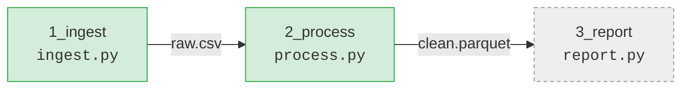

<!-- For a human, read years later by someone who has forgotten everything. Diagrams, not prose (prose ≤ ~150 words). Entities only: files, folders, arrows, status — never a rule or a tunable number (those live in AGENTS.md). -->
<!-- Only when there is nothing to draw: otherwise a README.html instead (templates/README.template.html), never both. -->

# <project-name>

**<One line: what this does, for whom.>**

## The big picture



<sub>green = live · red = broken · dashed = planned</sub>

## Folder map

```
<project-name>/
├── AGENTS.md          rules for agents (Claude and Codex)
├── doc/               companion files for the code
└── src/               …
```

---
Rules for agents: [`AGENTS.md`](AGENTS.md)
